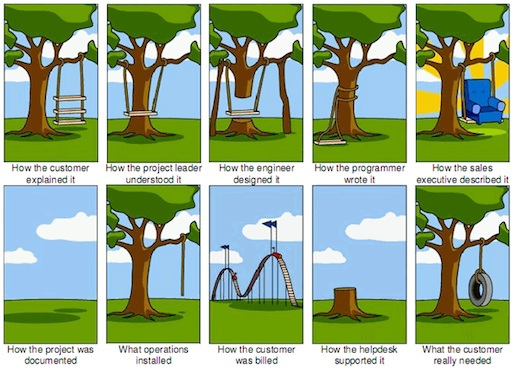

Every industry has things that could improve the workflow: more accuracy, more speed, less unnecessary work. If a developer wastes 20 minutes a day at a $60 hourly rate, that is:

  - $20 daily
  - $400 monthly
  - $4,800 yearly

A company that employs 1,000 developers would lose $4.8 million a year. In this blog post, I want to raise a yellow flag over a few things in software development that, in my opinion, are unnecessarily expensive and could be improved.

Remember that many 1% improvements can make a big difference in the long run: [https://jamesclear.com/marginal-gains](https://jamesclear.com/marginal-gains)

# Tickets

A big part of software development is writing requirements and tickets. It can be done in many ways, and it has a huge impact on how the work goes. Poorly defined tickets or requirements lead to slow work, frustration, and memes like this one:

Image source: [https://imgur.com/3O2kOG4](https://imgur.com/3O2kOG4)

Ambiguity during refinement is normal. But once a ticket is in the sprint, I believe it should be described in as much detail as possible. The time it saves can be spent on something more productive, like reading about exciting new tech.

## Ticket with only a title

**Ticket title**: User can remove article

A ticket this vague raises quite a few questions:

   - On which screen should the user be able to remove the article? Maybe with a swipe gesture, or with a remove button on the details screen?
   - Should I implement a confirmation alert?
   - Where can I find the design?

As you can see, even a simple ticket to remove an article can cause a lot of confusion. If the ticket were more complex, the list of questions would be much, much longer. Tickets like this generally create extra work, unless you are the one who wrote the ticket and you remember all the details.

In the worst case, the implementation looks like this:

  1. Thinking about what the author had in mind.
  2. Thinking "am I an idiot, that I do not understand it?"
  3. Searching for answers in documentation or references.
  4. Searching for the design.
  5. Asking people for the missing information. That disturbs their work, and it can block yours, since you may wait hours or even days for an answer. Switching to a different ticket in the meantime is an expensive context switch.
  6. Realizing that the ticket is blocked by another dependency that your team needs to fix first. And because the requirements were unclear, you might still implement things incorrectly and play ping-pong with QA. Adjusting the implementation to the correct behavior then requires:
        - fixing the issue
        - creating a pull request
        - running a CI build
        - doing a code review
        - fixing the code review comments
        - releasing a new build for QA

As you can see, the list can get really long. A poor ticket description can turn a simple task into an unpleasant, stressful journey that sometimes takes a couple of days.

## Tickets with many references

A ticket like this may contain all the knowledge needed to complete the task, but it takes time to go through all the links and filter out the information that actually relates to the ticket. Those pieces of information could have been added to the ticket during refinement.

## What should a great ticket look like?

Now, with the previous tickets in mind, what would you say about a ticket that looks like this:

**Title**: User can remove an article from the article details screen

### 📖 User Story

As a user, I would like to be able to remove the article on the details screen.

### Why is it needed? (optional, but useful for technical tickets that need a business case)

This feature was requested by many users in the feedback form.

### Description:

ButtonView with the Style.negative option can be used to match the design.

### Link to design:

[https://www.figma.com](https://www.figma.com)

### QA tips:

Creating articles requires a special admin account: use "Admin account" from 1Password.

### ✅ Acceptance criteria:

Dev | QA | Requirement | Comment
:---: | :---: | --- | ---
 ✅ | ✅ | Delete button is present on the article details screen. |
 :x: | :x: | It has the correct design. | Link to design.
 ✅ | ✅ | After tapping the delete button, a confirmation alert is displayed. |
 ✅ | ✅ | The delete confirmation alert has the correct design. | Link to design.
 ✅ | ✅ | On the delete confirmation alert: the Cancel button dismisses the alert and the article details stay visible. |
 ✅ | ✅ | On the delete confirmation alert: the Remove button dismisses the alert and closes the article details screen. |
 ✅ | ✅ | After removal, the article is not visible on the articles list. |
 ✅ | ✅ | All texts are localized. |

It is a huge difference, right? A little more time spent on writing the ticket saves much more time later. For me, writing detailed tickets also forces me to analyze the ticket in depth, clarify things I am not sure about, and discover blockers or dependencies that should be handled first.

Also remember that you will not always gather 100% of the requirements before implementation. That is perfectly fine, because the goal is to provide as many details as you can.

# How to measure if it paid off?

We want to optimize our work, not add to it. To do that, we should set goals we want to achieve and observe some metrics:

   - Fewer unknowns in tickets come up during development.
   - The number of bugs has decreased.
   - The QA team has more capacity.
   - The average number of story points the team completes has increased.
   - Planning is more precise, thanks to clearer requirements.
   - The happiness index has increased, because there is less frustration about ambiguous tickets.

This approach might not work in every case. That is why you should define clear goals and measure your progress toward them.

# Summary

In my experience, well-described tickets save a lot of time and frustration. When you put a ticket into the sprint, you should already know what is in its scope, and writing it down forces you to define clear requirements. Even if you are the one responsible for the ticket, do not rely solely on your memory. There is always a chance you will miss something important, and the cycle of "this was supposed to be a simple task" repeats.

When I wrote tickets like this in the past, I also noticed that detailed acceptance criteria led to fewer bugs. I hope these tips help you speed up development and limit the number of bugs.
